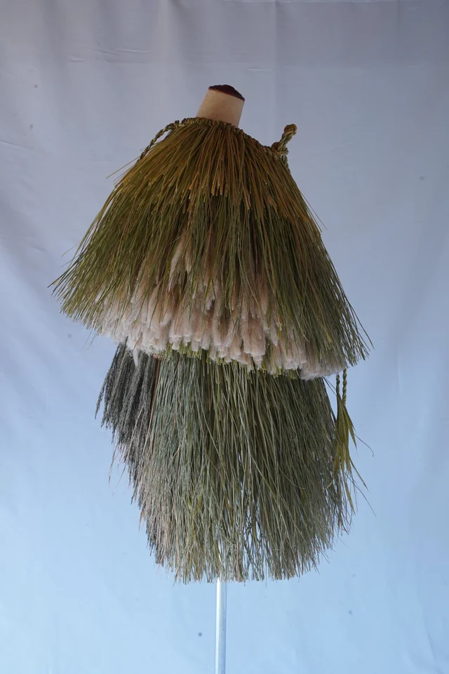

# Tetsuya Goto — サイト仕様書

後藤哲也の作品サイト。ビルド不要の静的サイトで、GitHub Pages で公開している。

**公開URL: https://gototetsuya.com/**

---

## 1. 公開の仕組み

| 項目 | 内容 |
|---|---|
| ホスティング | GitHub Pages（無料） |
| リポジトリ | `pii0622/Tetsuya-goto`（public） |
| 公開ブランチ | `main` / ルートディレクトリ |
| ビルド | **なし**。HTMLをpushすればそのまま公開される |
| 独自ドメイン | `gototetsuya.com`（`CNAME` ファイルで指定） |
| HTTPS | GitHubが自動発行。Settings → Pages の **Enforce HTTPS** がON |

`main` にマージすると1〜2分で反映される。フレームワークもnpmも使っていないので、HTMLを直接編集するだけでよい。

### CNAME ファイル

ルートの `CNAME`（中身は `gototetsuya.com` の1行のみ）が独自ドメインの設定を兼ねている。

- **このファイルを消すとサイトが `pii0622.github.io/Tetsuya-goto/` に戻り、独自ドメインが外れる**
- 逆に、このファイルを書き換えてマージすると GitHub Pages 側の設定も自動的に追従する

---

## 2. ドメインとDNS

### 現行ドメイン `gototetsuya.com`

| 項目 | 内容 |
|---|---|
| レジストラ | スタードメイン（ネットオウル） |
| ネームサーバー | `ns1〜ns3.star-domain.jp` |
| DNS管理画面 | スタードメイン管理ツール → DNSレコード設定 |
| サーバー契約 | なし（ドメインのみ） |

設定済みのレコード（NS×3・SOA は初めから存在するもので**削除不可**）：

| ホスト名 | 種別 | 内容 |
|---|---|---|
| （空欄） | A | `185.199.108.153` |
| （空欄） | A | `185.199.109.153` |
| （空欄） | A | `185.199.110.153` |
| （空欄） | A | `185.199.111.153` |
| （空欄） | AAAA | `2606:50c0:8000::153` |
| （空欄） | AAAA | `2606:50c0:8001::153` |
| （空欄） | AAAA | `2606:50c0:8002::153` |
| （空欄） | AAAA | `2606:50c0:8003::153` |
| `www` | CNAME | `pii0622.github.io` |

A/AAAA は GitHub Pages の固定アドレス。`www` へのアクセスは GitHub 側が自動的に本体へ転送する。

### 旧ドメイン `tetsuya-goto.com`

当初こちらで構築したが、URLを変更したため現在は使っていない。

- レジストラ・DNS: **Cloudflare**（Cloudflare Registrar で取得）
- 用途: なし。必要なら Cloudflare の Redirect Rules で `gototetsuya.com` へ301リダイレクトできる
- Cloudflare Email Routing を一度設定したが、現在は不要
- 更新時期が来たら、リダイレクトとして維持するか失効させるか判断する

---

## 3. ファイル構成

```
/
├── index.html        トップページ（本番）
├── price.html        価格ページ（メニュー非表示・noindex）
├── index2.html       トップページの複製（別用途・noindex）
├── price2.html       価格ページの複製（別用途・noindex）
├── 404.html          存在しないURLで表示される
├── CNAME             独自ドメイン指定
├── robots.txt        クローラー制御
├── sitemap.xml       サイトマップ
└── assets/
    ├── *.jpg / *.png 画像の原本
    ├── webp/         表示用フルサイズWebP
    └── thumb/        カード・サムネイル用（WebP + JPEGフォールバック）
```

CSSとJavaScriptは各HTMLの `<style>` / `<script>` に直接書かれている。外部ファイルはない。

### 1系と2系の違い

`index2.html` / `price2.html` は本番の複製で、違いは2点のみ。

1. 相互リンクが2系同士を指している
2. **価格表示が `Price on request`**（本番は `USD 7,000` などの具体額）

価格を出したくない相手に見せるための別系統。検索に出ないよう `noindex` と `robots.txt` で除外してある。本番側を編集したときは、**2系にも同じ変更を反映する必要がある**（自動同期はされない）。

---

## 4. ページの中身

### index.html のセクション

| ID | 内容 |
|---|---|
| `#top` | ヒーロー。全画面カルーセル（11枚）＋ `TETSUYA GOTO` の文字 |
| `#works` | 作品3点。クリックでライトボックス |
| `#film` | YouTube動画（ID: `UmLDz-GE_kk`）。サムネイルをクリックでページ内再生 |
| `#publications` | 出版物2点。クリックでライトボックス |
| `#about` | プロフィール（写真＋テキスト） |

### ライトボックス（作品の詳細表示）

作品カードは `<button class="card modal-trigger">` で、以下の `data-` 属性に情報を持たせている。JavaScriptがこれを読んでモーダルを組み立てる。

| 属性 | 内容 |
|---|---|
| `data-type` | `Work 01` などのラベル |
| `data-title` | 作品名 |
| `data-meta` | 技法・素材 |
| `data-text` | 解説文 |
| `data-images` | 画像パスのJSON配列。先頭がカードに表示される1枚 |

**解説文の改行について**: `data-text` の中で改行したい場所には、**属性値の中で実際に改行する**（HTMLソース上で行を分ける）。CSSの `white-space: pre-line` が改行として描画する。`\n` と文字で書くとそのまま画面に表示されてしまうので注意。

### 価格ページ

`price.html` はメニューから外してあり、`noindex` かつ `robots.txt` でクロール拒否。**URLを直接開けば表示できる**ので、必要な相手にURLを個別に渡す運用。

---

## 5. 画像の仕組み

初回表示を軽くするため、1枚の写真を**3種類**に展開している。

| 置き場所 | 用途 | 長辺 | 品質 |
|---|---|---|---|
| `assets/` | 原本（フォールバック用にも使う） | そのまま | — |
| `assets/webp/` | ライトボックスの拡大表示、カルーセル | カルーセル1800px / その他2048px | WebP 92 |
| `assets/thumb/` | カードのサムネイル、ライトボックス下部の小さな一覧 | 960px | WebP 86 / JPEG 86 |

### WebPとフォールバック

`` の `src` にWebPを指定し、`data-fb` 属性に元ファイルのパスを書いてある。WebPを表示できない環境では、JavaScriptの共通エラーハンドラが `data-fb` の画像に差し替える。

```html

```

`<picture>` を使っていないのは、既存のCSSセレクタとレイアウトを壊さないため。

JavaScript側のパス変換ヘルパー（`index.html` 内）：

```js
const fullSrc      = (src) => src.replace('assets/', 'assets/webp/').replace('.jpg', '.webp');
const thumbSrc     = (src) => src.replace('assets/', 'assets/thumb/').replace('.jpg', '.webp');
const thumbFallback = (src) => src.replace('assets/', 'assets/thumb/');
```

`data-images` には**原本のパス**（`assets/work1_01.jpg`）を書く。WebPやサムネイルへの変換はこのヘルパーが自動で行う。

### カルーセルの遅延読み込み

ヒーローの11枚を最初に全部読むと13MB以上になるため、`loadSlide()` が**表示中の1枚と次の1枚だけ**を読み込む。残りは切り替わる直前に読まれる。

この仕組みにより、初回表示は **7リクエスト / 約1.5MB** に収まっている。

### 画像を追加・差し替えるときの手順

1. 原本を `assets/` に置く（長辺2048px程度のJPEG）
2. 以下を実行してWebPとサムネイルを生成する（要 Python + Pillow: `pip install Pillow`）

```python
from PIL import Image
import os

NAMES = ['新しいファイル名']   # 拡張子なし。複数可
CAROUSEL = []                  # カルーセル用ならここに名前を入れる

def fit(im, m):
    w, h = im.size
    if max(w, h) <= m: return im
    k = m / max(w, h)
    return im.resize((round(w*k), round(h*k)), Image.LANCZOS)

for name in NAMES:
    im = Image.open(f'assets/{name}.jpg').convert('RGB')
    fit(im, 1800 if name in CAROUSEL else 2048).save(
        f'assets/webp/{name}.webp', quality=92, method=6)
    th = fit(im, 960)
    th.save(f'assets/thumb/{name}.webp', quality=86, method=6)
    th.save(f'assets/thumb/{name}.jpg', quality=86, subsampling=1,
            optimize=True, progressive=True)
```

3. HTMLを更新する
   - ライトボックスに追加するだけなら `data-images` の配列に原本パスを足す
   - カードの表示画像にするなら `` の `src` / `data-fb` / `width` / `height` も更新
   - カルーセルに追加するなら `heroImages` の配列に原本パスを足す

**3種類すべてを用意しないと画像が表示されない**（原本だけ置いてもWebPを探しに行って失敗する）ので注意。

---

## 6. お問い合わせ

**問い合わせ窓口はフッターのメールアイコンのみ。**

全ページのフッターに `mailto:vernacularworks@gmail.com` のアイコンリンクがある。クリックすると訪問者のメールソフトがこのアドレス宛に開く。

アドレスを変更する場合は、**4ファイルすべて**を修正する（`index.html` / `index2.html` / `price.html` / `price2.html`）。

```
grep -rn 'mailto:' --include='*.html' .
```

### 以前あったフォームについて

当初は Formspree を使ったお問い合わせフォームを `#contact` セクションに置いていたが、フッターのメールリンクと役割が重複するため削除した。あわせて送信完了ページ（`thanks.html`）も削除し、ナビゲーションからも Contact を外してある。

Formspree のアカウントとフォーム（ID: `xwvralab`）は残っているが、**どこからも参照されていない**。復活させる場合はフォームのHTML、`#contact` セクション、ナビゲーションのリンク、`thanks.html` をまとめて戻す必要がある。

---

## 7. 外部サービス一覧

| サービス | 用途 | 識別子 |
|---|---|---|
| GitHub Pages | ホスティング | `pii0622/Tetsuya-goto` |
| スタードメイン | ドメイン登録・DNS | `gototetsuya.com` |
| Cloudflare | 旧ドメインの管理 | `tetsuya-goto.com` |
| YouTube | 作品映像の埋め込み | `UmLDz-GE_kk` |
| Google Fonts | EB Garamond / Noto Sans JP / Shippori Mincho | — |
| Instagram | フッターのリンク先 | `@ttggss8` |

---

## 8. SEO設定

| 項目 | 設定 |
|---|---|
| canonical | `index.html` → `https://gototetsuya.com/` / `price.html` → `/price.html` |
| OGP画像 | `assets/og-image.jpg`（1200×630） |
| ファビコン | `assets/favicon.png`（ロゴから生成した180px） |
| sitemap.xml | トップページのみ登録 |
| robots.txt | `price.html` / `index2.html` / `price2.html` をクロール拒否 |
| noindex | `price.html` / `index2.html` / `price2.html` / `404.html` |

**ドメインを変更した場合、以下9箇所をすべて書き換える必要がある。**

- `CNAME`（1）
- `index.html`: canonical / `og:url` / `og:image`（3）
- `price.html`: canonical / `og:url` / `og:image`（3）
- `robots.txt`: `Sitemap:` 行（1）
- `sitemap.xml`: `<loc>`（1）

確認コマンド:
```
grep -rn '旧ドメイン' --include='*.html' --include='*.xml' --include='*.txt' . CNAME
```

---

## 9. よくある変更作業

### 価格を変える
`price.html` の `<div class="price-value">` を編集。`price2.html` は `Price on request` のままにするか、同様に編集するか用途次第。

### 作品の解説文を変える
該当カードの `data-text` 属性を編集。改行はソース上で実際に改行する。

### 作品を追加する
`index.html` の `.cards.work-cards` 内に `<button class="card modal-trigger">` を複製して追加し、`data-` 属性を埋める。画像は「画像を追加・差し替えるときの手順」に従って3種類生成する。`index2.html` にも同じ変更を入れる。

### Purchase（価格ページ）をメニューに戻す
`index.html` の `.desktop-nav` と `.mobile-nav` に `<a href="price.html">Purchase</a>` を追加。あわせて `price.html` の `noindex` を外し、`robots.txt` の `Disallow` を削除、`sitemap.xml` に追加する。

### ドメインを変える
「SEO設定」の11箇所を書き換え → 新ドメインのDNSを先に設定 → その後にマージ。**順番を逆にするとサイトが一時的に見られなくなる。**

---

## 10. 触ってはいけないもの

- **スタードメインの NS レコードと SOA レコード** — 削除するとドメイン全体の名前解決が止まり、サイトが完全に見られなくなる
- **`CNAME` ファイル** — 削除すると独自ドメインが外れる
- **`assets/webp/` と `assets/thumb/`** — 原本だけ残して消すと画像が表示されなくなる
- **フッターの `mailto:` リンク** — 唯一の問い合わせ窓口。消すと連絡手段がなくなる

---

## 11. 定期的に確認すること

| 項目 | タイミング | 備考 |
|---|---|---|
| `gototetsuya.com` の更新 | 年1回 | スタードメインから通知が来る。自動更新の設定を確認しておく |
| `tetsuya-goto.com` の扱い | 更新時期 | リダイレクト用に維持するか失効させるか |
| Enforce HTTPS | 設定変更の都度 | Settings → Pages。ドメインを変えると外れることがある |
| メールリンクの動作 | アドレス変更時 | フッターのアイコンをクリックして宛先が正しいか |

---

## 12. 動作確認のしかた

ローカルで確認する場合は、リポジトリのルートで簡易サーバーを立てる。

```
python3 -m http.server 8000
```

`http://localhost:8000/` を開く。ファイルを直接開く（`file://`）とJavaScriptのパス解決がうまくいかないので、必ずサーバー経由で確認すること。
